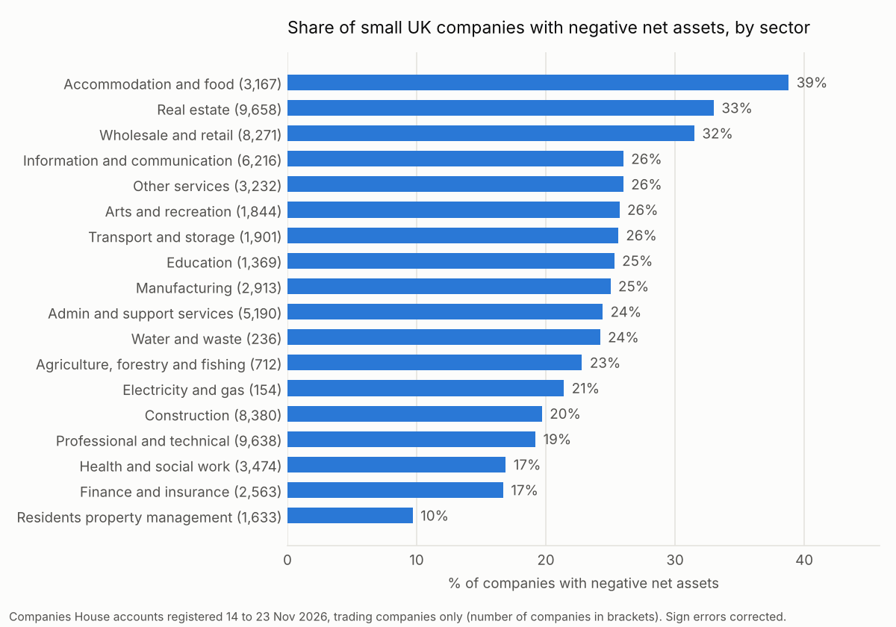

# UK SME Financial Health

How healthy are the balance sheets of small UK companies, and can you trust the numbers they file?

I work on credit risk data in my internship and wanted to see how much you can learn from public data alone. This project takes ten days of real company accounts from Companies House (84,151 sets of accounts registered 14 to 23 Nov 2026), loads them into PostgreSQL, maps the different ways companies tag the same item to one standard set of balance sheet items, checks the data for errors, and compares balance sheet health across sectors and company ages.

## Data

| Source | What it is | File used |
| --- | --- | --- |
| [Free Accounts Data Product](https://download.companieshouse.gov.uk/en_accountsdata.html) | Company accounts filed electronically, in inline XBRL (iXBRL) | Six daily files, `Accounts_Bulk_Data-2026-11-17.zip` to `-11-24.zip` (accounts registered 14 to 23 Nov 2026) |
| [Free Company Data Product](https://download.companieshouse.gov.uk/en_output.html) | Monthly snapshot of all live companies: status, SIC code, incorporation date | `BasicCompanyDataAsOneFile-2026-11-01.zip` |

The raw files are large and are not in this repository. Download them into `data/raw/` from the links above.

## How to run

```sh
pip install -r requirements.txt
docker run -d --name sme-pg -e POSTGRES_HOST_AUTH_METHOD=trust -p 5432:5432 postgres:16
./run.sh
```

`run.sh` parses the accounts, filters the company snapshot, then runs the SQL files in order.

| Step | File | What it does |
| --- | --- | --- |
| 1 | `scripts/parse_ixbrl.py` | Reads every `ix:nonFraction` figure with its period, dimensions, unit, scale and sign |
| 2 | `scripts/filter_companies.py` | Streams the 2 GB company snapshot and keeps only the companies in the sample |
| 3 | `sql/01_schema.sql` | Tables, keys and constraints |
| 4 | `sql/02_load.sql` | Loads the CSV files |
| 5 | `sql/03_mapping.sql` | Maps raw tags to 13 standard items and builds the `financials` table |
| 6 | `sql/04_checks.sql` | Data quality checks, results in `data_issues` |
| 7 | `sql/05_analysis.sql` | Sector and company age analysis |
| 8 | `sql/06_performance.sql` | Query time before and after indexes |
| 9 | `scripts/llm_map.py` | Optional: asks an LLM to map every tag (needs an API key in `.env`) |
| 10 | `scripts/evaluate_mapping.py` | Compares the rules and the LLM against a hand-labelled answer key |

## Results

**Scale.** 84,151 sets of accounts, 2,321,888 tagged figures, 929 different tags, 83,679 companies matched to the snapshot.

**Mapping.** 21 mapping rules cover 13 standard items. The same item is often tagged in different ways: creditors due within one year alone appears with three different sets of XBRL dimensions, and net assets is tagged either as `NetAssetsLiabilities` or as total `Equity`. Net assets was found for 98.5% of filings. `Creditors` with no dimensions is left unmapped on purpose, because some accounts use it for creditors due within one year and others for total creditors; it goes to the `needs_review` view.

**Rules vs an LLM.** This comparison was run on the 20 Nov file (1,133 balance sheet tag combinations). The rules were written by looking at the 100 most common tag combinations, so they get all of them right by design. To see how far an LLM gets without that hand work, `scripts/llm_map.py` sent all 1,133 balance sheet tag combinations (tag and dimension names only, no company data) to Claude Haiku 5.5 and asked for a standard item and a confidence score. Results against the hand-labelled answer key in `data/gold_labels.csv` (98 scored, 2 left out as ambiguous):

| Method | Correct | Share of figures |
| --- | --- | --- |
| 21 SQL rules | 98/98 | 100% |
| LLM, no hand-written rules | 92/98 | 93.2% |

All 6 LLM mistakes were the `FinancialInstrumentCurrentNon-currentDimension` style, which the model read as a split of the total rather than the total itself. Most came with low confidence, so sending answers below 0.6 to a person leaves 94 automatic mappings with 2 errors and 4 for review. In the 1,033 rarer combinations the LLM suggested 20 extra mappings (532 figures), for example IFRS names such as `CurrentLiabilities`. Checked by hand, only 5 of the 20 were right (`results/llm_tail_sample_for_review.csv`). 10 of the 15 wrong ones were consolidated group figures: the model found the right item but missed that the number covers a whole group, not one company. The others were parts of a total or cash flow statement values. So the LLM is a good first pass for common tags, but rare tags still need a person to check them. The run took 3 minutes (83,174 input and 49,971 output tokens). Full output: `results/mapping_comparison.md`.

**Data quality.** Checks on the current year balance sheet:

| Check | Filings flagged | Share |
| --- | --- | --- |
| Net current liabilities tagged without a minus sign | 4,481 | 5.3% |
| Net liabilities tagged without a minus sign | 3,669 | 4.4% |
| No net assets figure | 1,225 | 1.5% |
| Net current assets do not add up for another reason | 260 | 0.3% |
| Same company and date filed twice | 103 | 0.1% |
| Reported in USD or EUR | 69 | 0.1% |
| Possible unit error (about 1,000 times last year) | 66 | 0.1% |

The sign problem is the main finding: 5,055 filings (6.0%) have at least one of the two sign errors, and the rate is between 5.5% and 6.5% in every one of the six daily files. On the page the number is shown in brackets, for example (168,043), but the tag has no `sign="-"`, so software reads it as +168,043. In a random sample of 25 flagged filings from 20 Nov, the raw file of 24 showed the bracket or minus on the page with no sign in the tag (the automatic check picked the wrong tag in the other one). On the 20 Nov file, the first version of the net current assets check flagged 759 filings; most were false alarms because micro-entity accounts show prepayments and accruals on separate lines, and accruals are deducted after net current assets. After building that layout into the check, 27 were left (260 across all six files).

**Why it matters.** Taking the tags at face value, 20.1% of the 71,169 trading companies in the analysis have negative net assets. After fixing the sign errors the figure is 25.0%.



| Sector | Companies | Negative net assets | Current ratio below 1 | Median current ratio |
| --- | --- | --- | --- | --- |
| Accommodation and food | 3,167 | 38.8% | 56.4% | 0.84 |
| Real estate | 9,658 | 33.0% | 64.5% | 0.37 |
| Wholesale and retail | 8,271 | 31.5% | 43.1% | 1.10 |
| Construction | 8,380 | 19.7% | 35.9% | 1.29 |
| Professional and technical | 9,638 | 19.2% | 28.8% | 1.57 |
| Health and social work | 3,474 | 16.9% | 27.2% | 1.73 |

Full table: `results/by_sector.csv`. By company age, 31.1% of companies aged 2 to 4 years have negative net assets, against 17.6% of companies aged 10 or more (`results/by_age.csv`). Companies that already had a strike-off proposal at the start of November were weaker: 36.9% had negative net assets, against 24.8% of active companies (1,203 against 69,941 companies).

**Performance.** With 2.3 million rows in `raw_facts`, looking up one company's figures took about 125 ms with sequential scans and under 0.1 ms after adding indexes on `filings(company_number)` and `raw_facts(filing_id, tag)` (`results/06_performance_output.txt`).

## Limitations

- Ten days of filings, so the sample leans towards companies with filing deadlines at the end of November.
- Only electronically filed accounts are included.
- Most micro and small companies do not file a profit and loss account, so there is no revenue or interest data. Everything here is balance sheet only.
- Negative net assets is common in small companies (for example directors' loans) and does not mean a company is failing.
- The company snapshot was taken before these accounts were filed, so the strike-off comparison is not a prediction.
- Dormant, non-trading, non-GBP and flagged filings are left out of the analysis.

## Next steps

- Use a full year of filings from the monthly archive and check which companies were later dissolved or entered liquidation.
- Use the prior year figures in each filing to look at changes, after fixing sign errors in both years.
